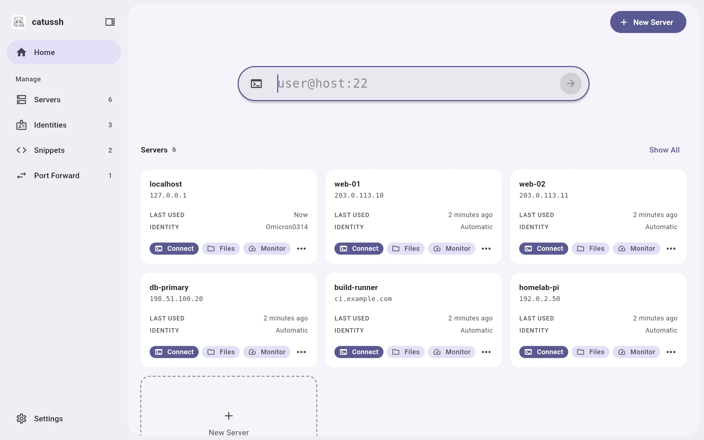
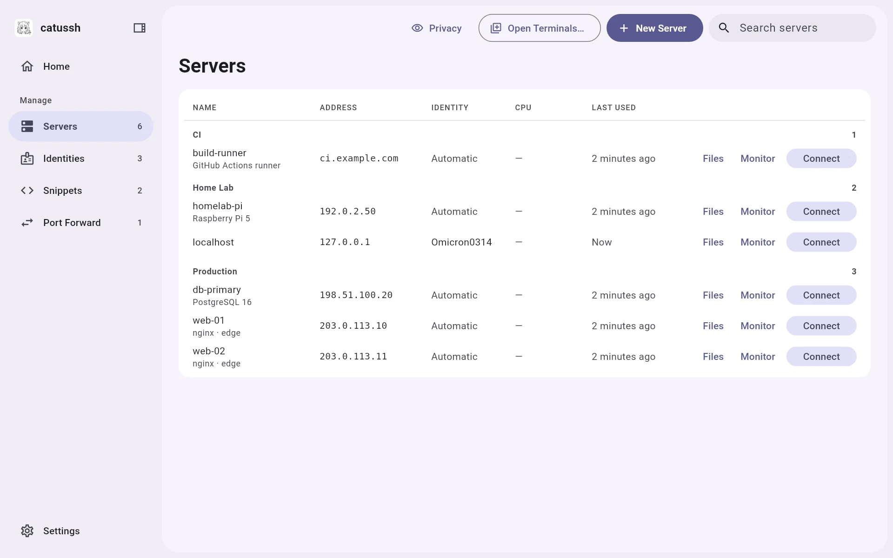
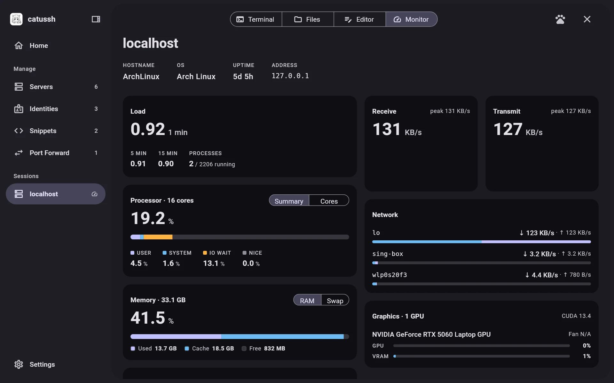
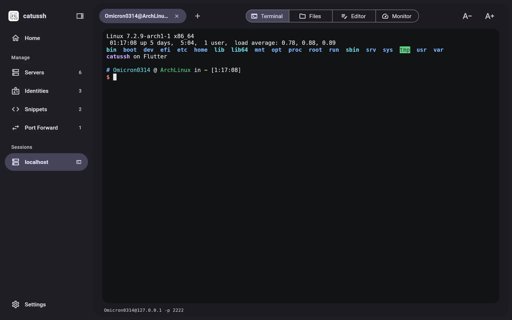
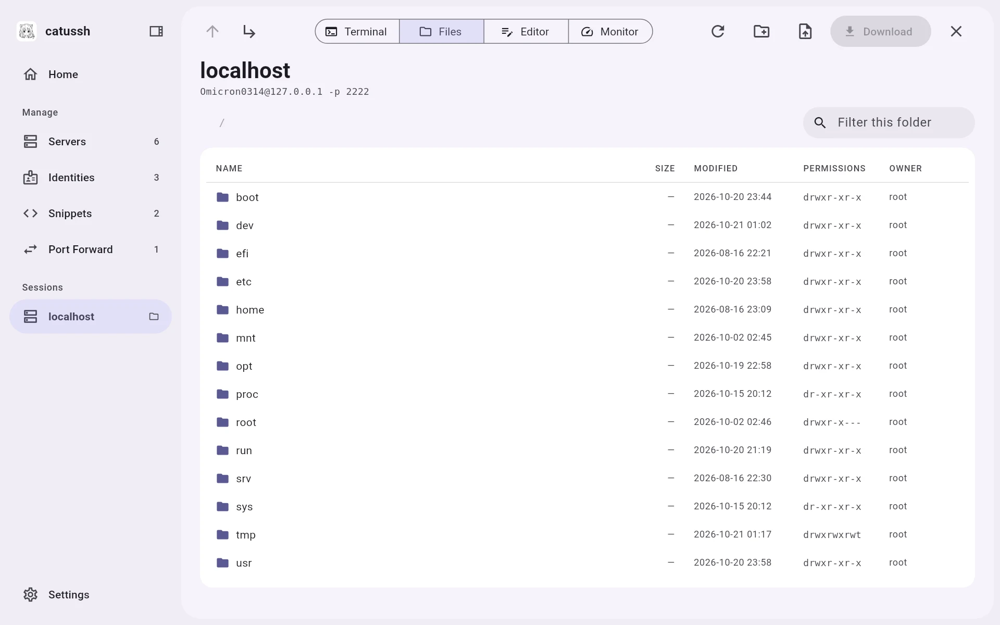
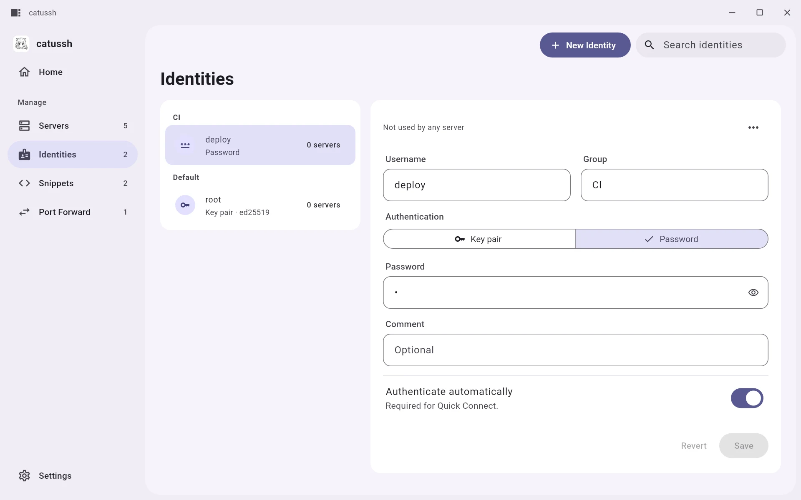
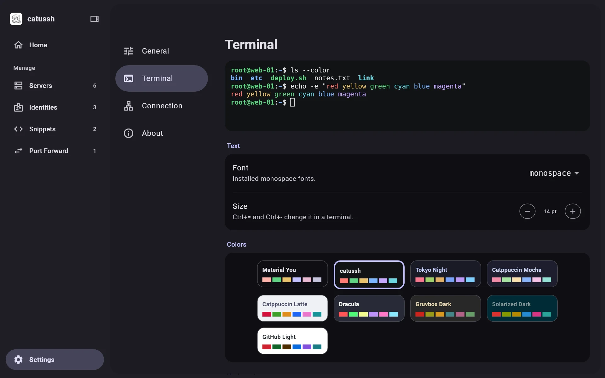
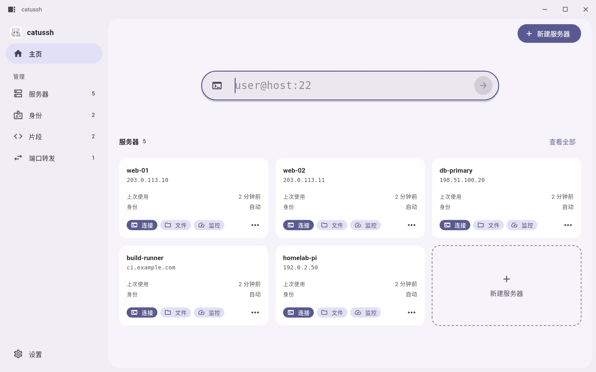
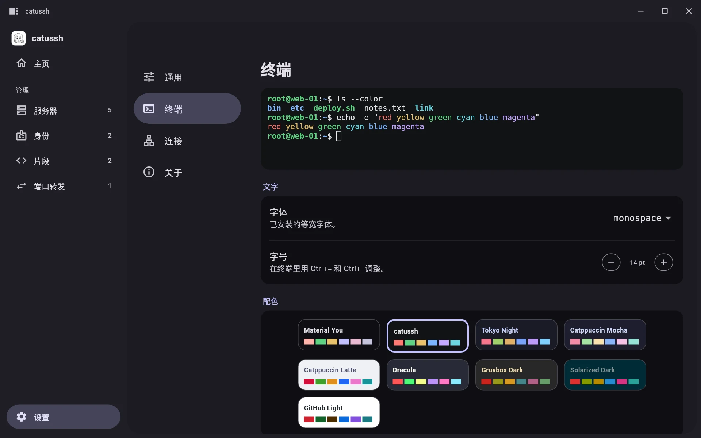

# catussh

[English](./README.md) · **简体中文**

为管理 Linux 和 macOS 服务器而生的 SSH 客户端，用 Flutter + Material You 重写：SSH 终端、
SFTP 文件传输（含文本编辑器）、实时资源监控，每台服务器并排可用。先做 Linux 桌面，
之后是 Android。界面支持英文和简体中文，跟随系统语言。

[](./LICENSE)


<picture>
  <source media="(prefers-color-scheme: dark)" srcset="./Resources/Screenshots/home-dark.webp">
  
</picture>

本仓库 fork 自原生 macOS 应用 [mizorewww/catussh](https://github.com/mizorewww/catussh)，
重写后可以在 SwiftUI 和 Ghostty 嵌入接口到不了的平台上运行。

## 安装（Linux）

需要 Flutter 3.47+、`clang cmake ninja pkgconf gtk3 libsecret`，以及一个 Secret Service
密钥环（GNOME Keyring 或 KWallet）。

```sh
git clone https://github.com/Omicron0314/catussh.git
cd catussh
bash Workflow/install-linux.sh        # Release 构建，安装到 ~/.local/opt/catussh
```

`bash Workflow/install-linux.sh --uninstall` 卸载。

## 功能

- **每台服务器都有终端、文件、编辑器和监控**，各一键打开；会话工具栏可以来回切换，
  侧栏里每台打开了会话的服务器占一行。
- **快速连接**：输入 `user@host`、`user@host:2222` 或完整的 `ssh` 命令后回车；
  会提示最近用过的命令（Ctrl+Enter）。
- **服务器监控**（Linux 和 macOS）：CPU（含每核）、内存、交换、磁盘、网络和 NVIDIA GPU，
  无需安装 agent。
- 多台服务器共用的**身份**（密码或密钥）、可以在多台服务器上同时运行的**片段**、
  **端口转发**（本地和远程），以及**托盘猫**：每台服务器一只在系统托盘里奔跑的猫，
  跑得多快取决于 CPU 占用。
- **校验主机密钥**：首次连接时保存，之后密钥变了就拒绝连接。
- 服务器、身份和片段加密存储（AES-256-GCM），密钥放在系统密钥环里。
- **Material You**：配色取自桌面强调色（也可以自选），支持浅色、深色和跟随系统；
  窗口标题栏（拖动、最小化、最大化、关闭）由应用自己用这套颜色绘制，不再用系统的。
- **中英文界面**：默认跟随系统语言，可在 设置 › 通用 › 语言 中切换。日期和“几分钟前”
  这类相对时间也会跟着变；服务器名称、路径和终端内容保持原样。

## 截图

| | |
|---|---|
|  |  |
|  |  |
|  |  |
|  |  |

## 快捷键

| | |
|---|---|
| 新建服务器 | Ctrl+Shift+N |
| 设置 | Ctrl+, |
| 显示或隐藏侧栏 | Ctrl+\\ |
| 在这台服务器上新开终端 / 关闭 | Ctrl+Shift+T / Ctrl+Shift+W |
| 终端字号 | Ctrl+= / Ctrl+- |
| 终端复制 / 粘贴 | Ctrl+Shift+C / Ctrl+V |
| 文件：上一级、前往文件夹、刷新 | Alt+Up、Ctrl+Shift+G、Ctrl+R |
| 编辑器：保存、打开、关闭文件 | Ctrl+S、Ctrl+O、Ctrl+W |

## 开发

```sh
flutter test                                   # 单元测试（解析器、存储、known hosts……）
flutter run -d linux
```

连真实服务器测试（临时起一个用户级 sshd 即可）：

```sh
CATUSSH_TEST_SSHD="127.0.0.1:2222:$USER:/path/to/key" flutter test test/ssh_integration_test.dart
CATUSSH_SHOTS=/tmp/shots flutter test test/tool/screenshots_test.dart   # 渲染截图
```

`CATUSSH_DATA_DIR=/tmp/profile` 用单独的配置目录运行，密钥存在文件里（不要用于真实数据）；
`CATUSSH_OPEN=monitor:<服务器名>` 启动时直接打开某台服务器的工具。截图由
`test/tool/screenshots_test.dart` 渲染（设置 `CATUSSH_SHOTS`；需要 `python3` 和
`fontTools`，用来从系统 Noto 字体集里取出一个中文字面）。

窗口特意不带系统装饰：`linux/runner/my_application.cc` 关掉了 GTK 标题栏，
`lib/features/shell/title_bar.dart` 自己绘制拖动区域和三个窗口按钮。平铺窗口管理器里
窗口大小由布局决定；浮动时用合成器自己的鼠标绑定调整大小。

## 许可

MIT。基于 mizorewww 的 catussh，它是 Lakr Aream 的 Rayon 的延续。
